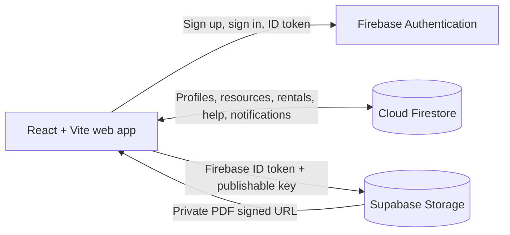

# HelpHub

**Share Resources. Exchange Knowledge. Help Each Other.**

HelpHub is a student-focused resource-sharing and peer-support web app. Members can publish study resources, access shared PDFs, arrange offline rentals of physical notes, and ask classmates for help. The application is a single-page React app backed by Firebase Authentication and Cloud Firestore, with Supabase Storage for PDF and profile-photo files.

**Live app (Vercel):** [https://help-hub-topaz.vercel.app](https://help-hub-topaz.vercel.app)

**GitHub repository:** [pratigyasachdeva/HelpHub](https://github.com/pratigyasachdeva/HelpHub)

**Additional frontend deployment:** [https://helphub-platform.web.app](https://helphub-platform.web.app) (Firebase Hosting)

## Table of contents

- [What HelpHub does](#what-helphub-does)
- [Technology](#technology)
- [Application architecture](#application-architecture)
- [Getting started](#getting-started)
- [Firebase setup](#firebase-setup)
- [Supabase Storage setup](#supabase-storage-setup)
- [Environment variables](#environment-variables)
- [Data model](#data-model)
- [Security notes](#security-notes)
- [Run and deploy](#run-and-deploy)
- [Deploy to Vercel](#deploy-to-vercel)
- [Known scope and limitations](#known-scope-and-limitations)
- [Troubleshooting](#troubleshooting)
- [Contributing](#contributing)
- [License](#license)

## What HelpHub does

### Accounts and profiles

- Register and sign in with email and password.
- Request a password reset through Firebase Authentication.
- Maintain a profile with a display name, campus/location, biography, and photo.
- Use role-aware routes for members and administrators.

### Study resource library

- Upload listings with a title, subject, category, description, keywords, and page count.
- Offer a digital PDF, a physical copy for rent, or both.
- Browse and search approved resources and open their details.
- Download PDFs through time-limited signed links.
- Track views, downloads, unique downloaders, and resource ratings/helpfulness feedback.
- Manage your own listings and their physical-rental availability.

### Physical notes rentals

- Set a physical copy's daily rental rate from **₹3 to ₹10 per day**.
- Send a rental request with dates and an optional pickup note.
- View incoming owner requests and outgoing borrowed rentals.
- Follow the request lifecycle: pending, accepted/rejected, handover, and return.
- Record payment as **offline/cash on handover**; the app does not process payments.

### Community help and notifications

- Post study questions, project blockers, and resource requests.
- Offer help on another member's request and let its author accept an offer.
- Receive in-app notifications for rental requests/status changes and help offers.
- View and mark notifications as read.

### Administration

- View platform counts for users, resources, downloads, rentals, and help requests.
- Review reports, manage account status, and remove resource listings.
- Admin access is assigned manually by a trusted project administrator; public signup cannot select the admin role.

## Technology

| Area                      | Technology                                                          |
| ------------------------- | ------------------------------------------------------------------- |
| UI                        | React 18, Vite, Tailwind CSS                                        |
| Routing                   | React Router                                                        |
| Icons                     | Lucide React                                                        |
| Authentication            | Firebase Authentication (email/password)                            |
| App data and live updates | Cloud Firestore                                                     |
| PDF and avatar files      | Supabase Storage                                                    |
| Frontend hosting          | Vercel (primary live app); Firebase Hosting (additional deployment) |

## Application architecture



The frontend talks directly to Firebase and Supabase using their browser SDKs. Firestore rules and Supabase Storage policies enforce data access; there is no custom application server in this repository.

The main code areas are:

```text
src/
├── components/       Shared layout and UI components
├── features/         Authentication, resources, rentals, help, admin screens
├── pages/            Landing, dashboard, and notifications pages
├── services/         Firebase and Supabase data/storage operations
├── firebase/         Firebase app/Auth/Firestore initialization
├── supabase/         Supabase client initialization
└── utils/            Shared date and pricing helpers

firestore.rules       Cloud Firestore security rules
firestore.indexes.json Required compound Firestore indexes
supabase/             Supabase Storage policy SQL
```

## Getting started

### Prerequisites

- Node.js 20 or newer and npm.
- A Firebase project with a registered **Web app**.
- A Supabase project if you want PDF uploads and avatar storage.
- A Google account with permission to configure/deploy the Firebase project.

### Install and configure

```bash
git clone https://github.com/pratigyasachdeva/HelpHub.git
cd HelpHub
npm install
cp .env.example .env
```

Edit `.env` with the Firebase Web App values and Supabase project URL and publishable key. See [Environment variables](#environment-variables). Never copy another developer's project-specific keys into your own environment.

Configure Firebase and Supabase by following the sections below, then start the app:

```bash
npm run dev
```

Vite prints the local URL (normally `http://localhost:5173`). The `.env` file is ignored by Git and must be created separately on each developer machine.

## Firebase setup

1. Create or select a Firebase project in the [Firebase Console](https://console.firebase.google.com/).
2. Add a **Web app** and copy its configuration into `.env`.
3. In **Authentication → Sign-in method**, enable **Email/Password**.
4. Create a **Cloud Firestore** database. Review `firestore.rules` before using real user data.
5. Add your local and production web domains under Firebase Authentication's authorized domains if they are not already listed.
6. Deploy the repository's rules and indexes (see [Run and deploy](#run-and-deploy)).

The Supabase Storage policies in this repository are written for the Firebase project ID `helphub-platform`. If you use a different Firebase project ID, update the issuer and audience values in `supabase/storage-policies.sql` before applying the SQL.

### Creating the first administrator

Public registration creates only `student` or `community_member` profiles. To make an administrator, first register the account normally, then use a trusted admin method to update that user's Firestore `users/{uid}` document to `role: "admin"`. The included Firestore rules allow public users to update their profile but prevent them from changing their own role. Protect administrator access and never expose a Firebase Admin SDK service-account key in this frontend repository.

## Supabase Storage setup

Supabase is used for **file storage**, while Firebase remains the app's authentication and Firestore data source.

1. Create a Supabase project and copy its **Project URL** and **publishable key** into `.env`.
2. Configure Firebase as a third-party authentication provider in Supabase Auth, using the Firebase project's ID/token issuer as required by Supabase.
3. In Supabase Storage, create these buckets:
   - `resource-pdfs` — **private**; PDFs are delivered using signed URLs.
   - `avatars` — **public**; profile photos use public URLs.
4. Open the Supabase SQL Editor and apply `supabase/storage-policies.sql`.
5. Confirm that the Firebase issuer/audience in the SQL matches the Firebase project used by the app.

PDF uploads are limited by the UI to PDF files up to 25 MB. Objects are stored under a folder named for the uploading user's Firebase UID. The SQL policies check the Firebase token and restrict writes/deletes to that user's folder.

## Environment variables

Copy `.env.example` to `.env` and set every value for the Firebase and Supabase projects you configured:

| Variable                            | Purpose                                 | Source                                          |
| ----------------------------------- | --------------------------------------- | ----------------------------------------------- |
| `VITE_FIREBASE_API_KEY`             | Firebase Web App project/app identifier | Firebase Console → Project settings → Your apps |
| `VITE_FIREBASE_AUTH_DOMAIN`         | Firebase Authentication domain          | Firebase Web App configuration                  |
| `VITE_FIREBASE_PROJECT_ID`          | Firebase project ID                     | Firebase Web App configuration                  |
| `VITE_FIREBASE_STORAGE_BUCKET`      | Firebase Storage bucket config value    | Firebase Web App configuration                  |
| `VITE_FIREBASE_MESSAGING_SENDER_ID` | Firebase messaging sender config        | Firebase Web App configuration                  |
| `VITE_FIREBASE_APP_ID`              | Firebase Web App ID                     | Firebase Web App configuration                  |
| `VITE_SUPABASE_URL`                 | Supabase project URL                    | Supabase Dashboard → Project settings → API     |
| `VITE_SUPABASE_PUBLISHABLE_KEY`     | Browser-safe Supabase key               | Supabase Dashboard → Project settings → API     |

All `VITE_` variables are bundled into browser code at build time. Firebase web API keys and Supabase publishable keys are intended for client apps, but they do **not** replace security rules or storage policies. Never put a Supabase `secret`/`service_role` key, private credentials, or Firebase Admin service-account JSON in a `VITE_` variable.

For production builds, configure the same variables in the hosting/build environment. Vercel needs these variables in its Project Settings before deployment. Firebase Hosting does not read your local `.env` file after the build has been created.

## Data model

The app stores operational records in Cloud Firestore. Important collections include:

| Collection       | Purpose / key fields                                                                                  |
| ---------------- | ----------------------------------------------------------------------------------------------------- |
| `users`          | Public profile, role, account status, contribution counts; document ID is the Firebase UID            |
| `resources`      | Study listing metadata, owner, file path, soft/hard-copy options, availability, counters, and ratings |
| `downloads`      | Per-user/resource download record and download counts                                                 |
| `rentalRequests` | Renter, owner, resource, dates, price, message, and lifecycle status                                  |
| `rentalHistory`  | Completed rental summary created when a copy is returned                                              |
| `notifications`  | In-app notification addressed to a Firebase UID, read state, and destination link                     |
| `helpRequests`   | Community question/request, author, urgency, and accepted offer fields                                |
| `helpOffers`     | A member's offer to help with a request and its status                                                |
| `reviews`        | One review per transaction/reviewer, with rating and helpfulness                                      |
| `reports`        | User-submitted reports and their moderation status                                                    |

Some list views use live Firestore listeners. `firestore.indexes.json` contains the compound indexes needed for filtered/sorted listings, including incoming and outgoing rental requests. Newly deployed indexes may take time to finish building before those queries work.

## Security notes

- Review and deploy `firestore.rules`; do not rely on hiding client configuration values for access control.
- Keep public signup roles restricted. Promote administrators only through trusted console/Admin SDK access.
- Supabase Storage must have the two buckets and matching policies described above. Do not use a service-role/secret key in the browser.
- The included Supabase SQL currently trusts Firebase project `helphub-platform`; update it if you fork the app to another Firebase project.
- Firebase web API keys are not authorization secrets. Restrict their allowed APIs in Google Cloud where appropriate, and use Firebase Security Rules (and App Check where configured) to protect data/services.
- Use test accounts and non-sensitive sample files while developing. Review all policies before opening the app to the public.

## Run and deploy

### Local Development and Production Build

To run HelpHub locally, install the dependencies and start the Vite development server:

```bash
npm install
npm run dev
```

To create and preview a production build:

```bash
npm run build
npm run preview
```

### Deploy Firestore Rules and Indexes

Firebase is still used for Authentication and Cloud Firestore. Deploy the Firestore security rules and indexes using Firebase CLI:

```bash
npx firebase-tools login
npx firebase-tools deploy --only firestore:rules,firestore:indexes --project helphub-platform
```

For the original project, the Firebase project ID is `helphub-platform`. In Firebase Console → Firestore → Indexes, wait until the required indexes show **Enabled**. A **Building** status means the index is not ready yet.

### Deploy the web app to Firebase Hosting (additional deployment)

Make sure your production environment variables are available before building. Then run:

```bash
npm run build
npx firebase-tools deploy --only hosting --project helphub-platform
```

To deploy all resources declared in `firebase.json` (Hosting, Firestore rules, and indexes), build first and run:

```bash
npm run build
npx firebase-tools deploy --project helphub-platform
```

Alternatively, `npm run deploy:all` runs the build and deploys to the Firebase project already selected in the CLI. The first deploy may require selecting or creating a Firebase Hosting site. Check the Firebase CLI output for the final hosted URL.

## Deploy to Vercel

HelpHub is hosted primarily on **Vercel**, which provides production deployment and automatic deployments through GitHub integration. Firebase continues to handle Authentication and Cloud Firestore, while Supabase is used for PDF and profile-photo storage.

The current primary live frontend is [https://help-hub-topaz.vercel.app](https://help-hub-topaz.vercel.app). The GitHub repository is [pratigyasachdeva/HelpHub](https://github.com/pratigyasachdeva/HelpHub).

### Deployment Steps

1. Push the latest project code to the GitHub repository.
2. Log in to [Vercel](https://vercel.com/) using your GitHub account.
3. Import the `pratigyasachdeva/HelpHub` repository.
4. Configure the project with the following settings:
   - **Framework Preset:** Vite
   - **Root Directory:** `./`
   - **Build Command:** `npm run build`
   - **Output Directory:** `dist`
   - **Install Command:** `npm install`

5. Add all required `VITE_` environment variables from `.env` to Vercel Project Settings. Configure them for the Production environment (and Preview if required).
6. Click **Deploy** to build and publish the application.

The required `VITE_` variables are embedded in the browser bundle at build time. If you change them, redeploy the application.

The `vercel.json` file rewrites app routes to `index.html`, allowing direct visits to dashboard routes.

### Automatic Deployment

The GitHub repository is connected to Vercel. Whenever new changes are pushed to the `main` branch, Vercel automatically builds and deploys the updated application.

### Post-Deployment Configuration

1. Add the Vercel production hostname to Firebase Authentication's authorized domains.
2. Verify Firebase Authentication and Cloud Firestore connectivity.
3. Confirm that Supabase Storage buckets and access policies are configured correctly.
4. Test user registration, login, password reset, PDF uploads, downloads, and profile-photo functionality.

**Note:** Vercel hosts the primary frontend application. Firebase Authentication, Firestore security rules and indexes, and Supabase Storage operate independently. Firebase Hosting remains available as an additional frontend deployment at [https://helphub-platform.web.app](https://helphub-platform.web.app).

## Known scope and limitations

- The app uses Firebase Authentication email/password; password reset messages are sent by Firebase's configured email workflow.
- Notifications are **in-app Firestore notifications**. This repository does not implement browser push notifications or an email notification server.
- Physical rentals are coordinated offline. There is no payment gateway, automatic identity verification, delivery service, or dispute-resolution workflow.
- PDF access uses signed URLs that expire after one hour. The listing and metadata live in Firestore; the PDF itself lives in Supabase Storage.
- The app is a frontend-first student project and does not include a separate backend/API server or automated test suite at this time.

## Troubleshooting

### `firebase: command not found`

Run the Firebase CLI via `npx` from the project directory:

```bash
npx firebase-tools login
npx firebase-tools deploy --only firestore:rules,firestore:indexes --project helphub-platform
```

### Rental list is empty but a notification says a request arrived

Check Firestore → Indexes. The `rentalRequests` indexes for `ownerId + createdAt` and `renterId + createdAt` must be **Enabled**. Deploy the latest `firestore.indexes.json` and refresh after index creation completes. The rentals page also displays a query error if Firestore rejects the listener.

### Supabase upload returns a permission or bucket error

Confirm `VITE_SUPABASE_URL` and `VITE_SUPABASE_PUBLISHABLE_KEY` are from the intended Supabase project, both buckets exist with the correct privacy, the Firebase third-party auth integration is configured, and `supabase/storage-policies.sql` matches the Firebase project ID. Restart Vite after editing `.env`.

### Firebase login or reset email does not work

Confirm Email/Password is enabled in Firebase Authentication, the account belongs to the same Firebase project configured in `.env`, and the current hostname is an authorized domain. For reset email delivery, check spam/all mail and the Firebase Authentication email template and usage. The UI's generic success state is not proof that an email reached the inbox.

### Local app still shows old configuration

Vite reads environment values when it starts/builds. Stop and restart `npm run dev` after changing `.env`; rebuild before deploying Hosting.

## Contributing

1. Fork the repository and create a focused feature branch.
2. Keep credentials in a local `.env`; commit only `.env.example` placeholders.
3. Keep Firestore rules/indexes and Supabase Storage policies aligned with any schema changes.
4. Run `npm run build` before submitting changes.
5. Describe the change and any Firebase/Supabase console setup required in the pull request.

## License

No license file is currently included. Add a `LICENSE` file before granting reuse rights or publishing the project for external contributions.
